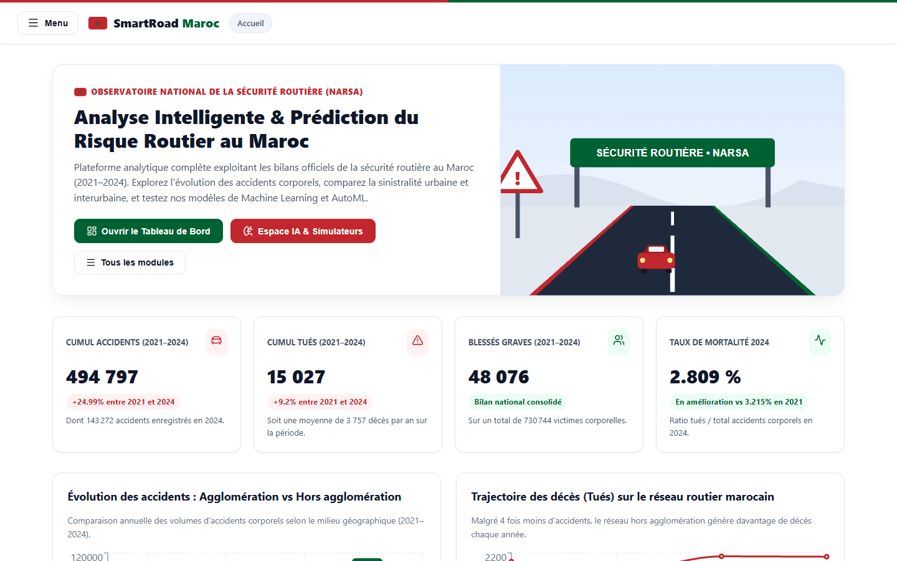
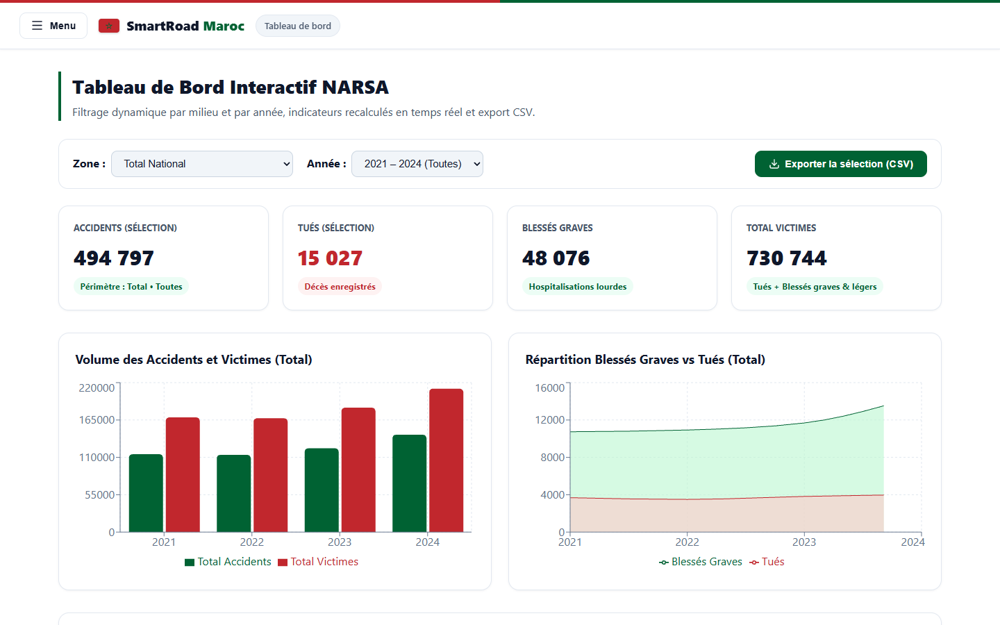
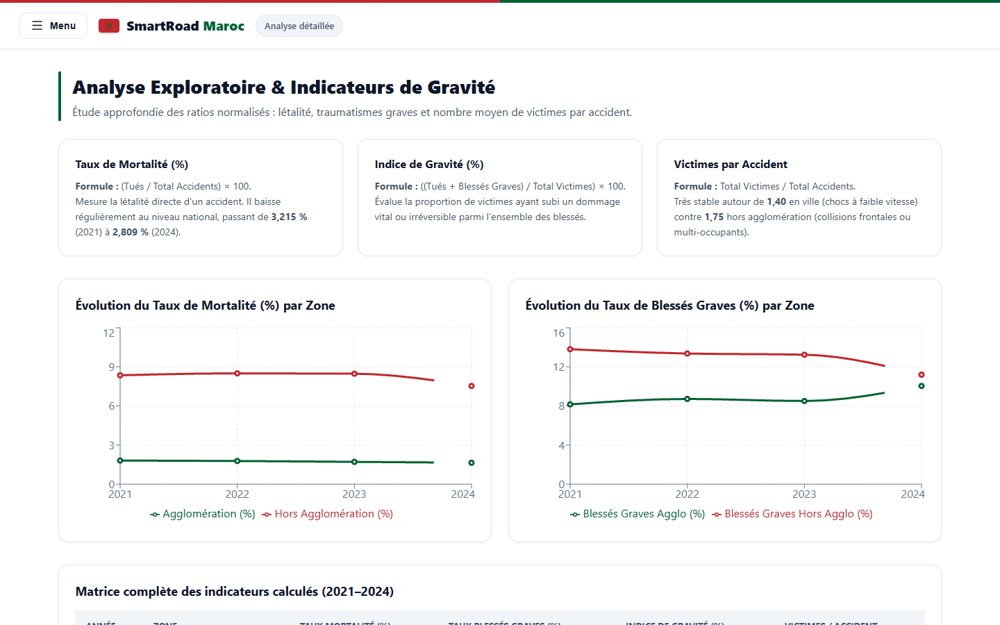
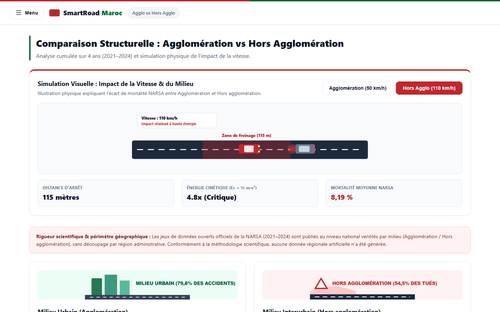
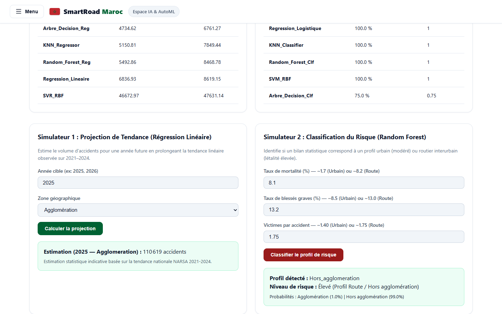
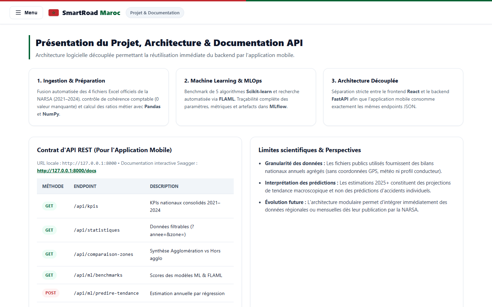
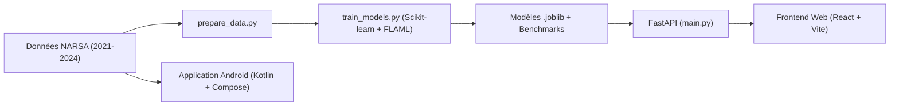

# SmartRoad Maroc

Plateforme d'analyse statistique, de simulation physique et de modélisation Machine Learning des accidents corporels de la circulation au Maroc à partir des données ouvertes officielles de la **NARSA** (2021-2024).


---

## Aperçu du Projet

Entre 2021 et 2024, les bilans nationaux de la **NARSA** recensent **494 797 accidents corporels**, **15 027 tués** et **730 744 victimes**. L'analyse met en évidence un contraste marqué entre les deux milieux :
- **En agglomération** : **79,8 %** du volume total des accidents (394 684), mais une mortalité moyenne contenue à **1,74 %**.
- **Hors agglomération** : **20,2 %** des accidents (100 113), mais **54,5 %** des décès du pays (8 196 tués), avec un taux de mortalité moyen de **8,22 %** (environ **4,7 fois plus létal** qu'en ville).

Au niveau national, le taux de mortalité est passé de **3,215 %** en 2021 à **2,809 %** en 2024.

---

## Version Web (React + FastAPI)

| Accueil & Synthèse Nationale | Tableau de Bord & Export CSV |
| :---: | :---: |
|  |  |

| Analyse Détaillée & Ratios | Agglo vs Hors Agglo & Simulation |
| :---: | :---: |
|  |  |

| Espace IA, Benchmarks & Simulateurs | Architecture & Contrat REST |
| :---: | :---: |
|  |  |

---

## Application Mobile Android (Kotlin + Jetpack Compose)

L'application native Android (`mobile/`, package `ma.narsa.smartroad`) reprend l'ensemble des analyses NARSA et des simulateurs dans une interface inspirée de l'écosystème **ONCF Voyages** (Bleu Royal `#14213D`, Orange Solaire `#FF6B00`, Cyan `#0284C7`), avec support complet **Français / عربي (RTL)** et mode **Jour / Nuit**.

- **Ouverture Zellige Marocain** : Animation vectorielle géométrique (rosace `Shamsa` à 16 pétales, entrelacs `Tafsil` et étoiles `Khatam` à 8 branches).
- **Corridor Autoroutier Intelligent (3 voies)** : Simulation temps réel avec distance de sécurité, clignotants préventifs et dépassements autonomes.
- **Cockpit Freinage & Collision** : Compteur 240 degrés, mode automatique (temps de réaction NARSA) ou manuel (pédale *Maintenir le frein*), transfert de masse, fumée/eau au freinage et modélisation de collision avec transfert d'énergie cinétique (`kJ`).
- **Simulateur IA & AutoML** : Projection de tendance (2025-2035) calculée à la demande avec trajectoire complète, classifieur de profil de risque Random Forest et benchmarks LOOCV.
- **100 % Autonome** : Données NARSA et modèles embarqués directement dans l'application (aucun serveur requis).

> L'APK prêt à installer (`SmartRoad-Maroc-v2.0.0.apk`) est disponible dans la section **[Releases](../../releases)**.

---

## Architecture



---

## Installation et Exécution

### 1. Backend FastAPI & Frontend Web

```powershell
# Backend
python -m venv .venv
.\.venv\Scripts\activate
pip install -r requirements.txt
uvicorn main:app --reload --port 8000

# Frontend (dans un second terminal)
cd frontend
npm install
npm run dev
```

### 2. Application Android (APK)

- **Installation directe** : Téléchargez `SmartRoad-Maroc-v2.0.0.apk` depuis les **Releases** GitHub et installez-le sur Android 8.0+ (`minSdk 26`).
- **Compilation depuis les sources** :

```powershell
cd mobile
.\gradlew.bat assembleDebug
```

L'APK généré se trouve dans `mobile/app/build/outputs/apk/debug/app-debug.apk`.

---

## Structure du Dépôt

```text
smartroad-maroc/
├── data/                  # Fichiers Excel officiels NARSA et CSV nettoyé
├── docs/screenshots/      # Captures d'écran de la plateforme
├── frontend/              # Application Web React + Vite + Recharts
├── mobile/                # Application Android native (Kotlin + Jetpack Compose)
├── models/                # Modèles entraînés (.joblib) et benchmarks LOOCV
├── main.py                # API REST FastAPI
├── prepare_data.py        # Pipeline d'ingestion et calcul des indicateurs
└── train_models.py        # Entraînement et évaluation LOOCV + MLflow
```

---

## Limites Scientifiques

- **Granularité** : Les fichiers publics NARSA (2021-2024) fournissent des bilans nationaux annuels agrégés par milieu (Agglomération / Hors agglomération), sans découpage régional ni coordonnées GPS.
- **Projections** : Les estimations 2025+ issues de la régression linéaire constituent des projections macroscopiques indicatives.
